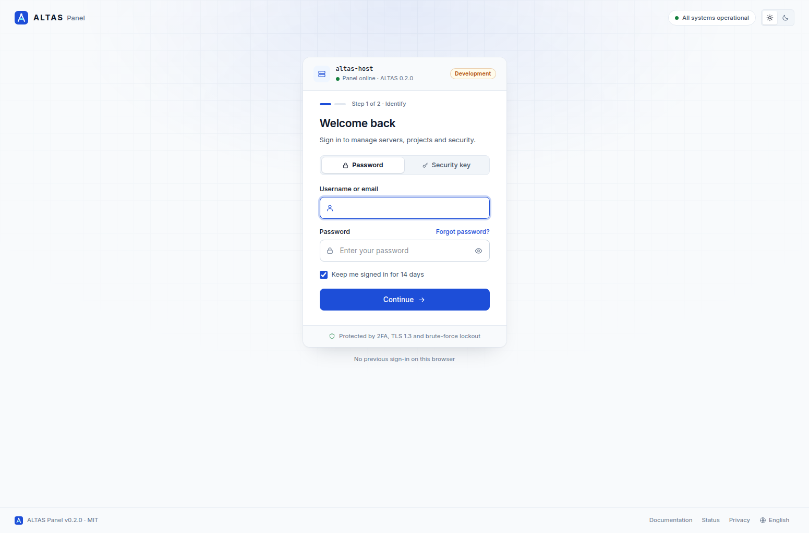
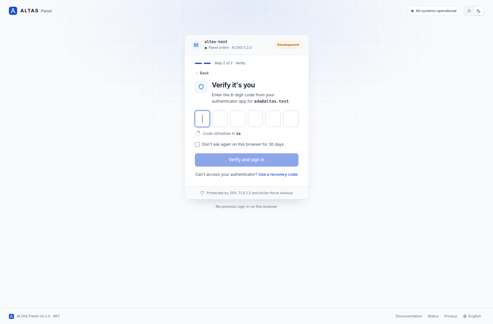
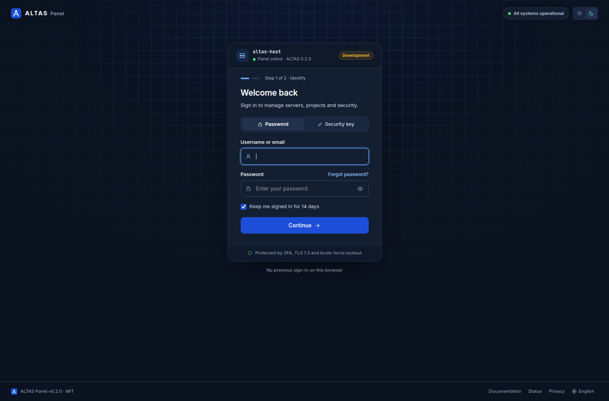
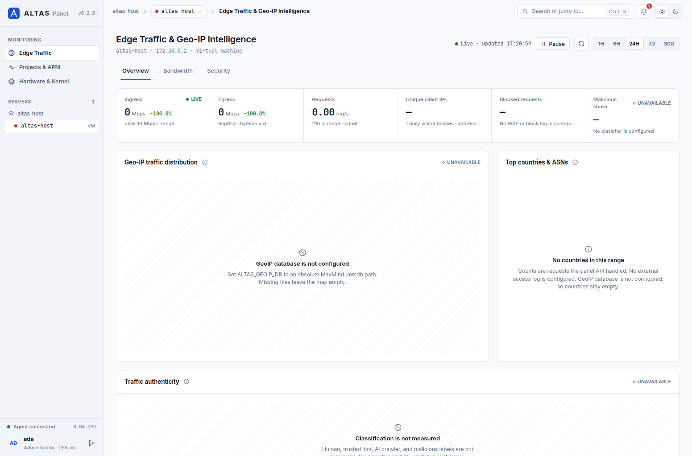
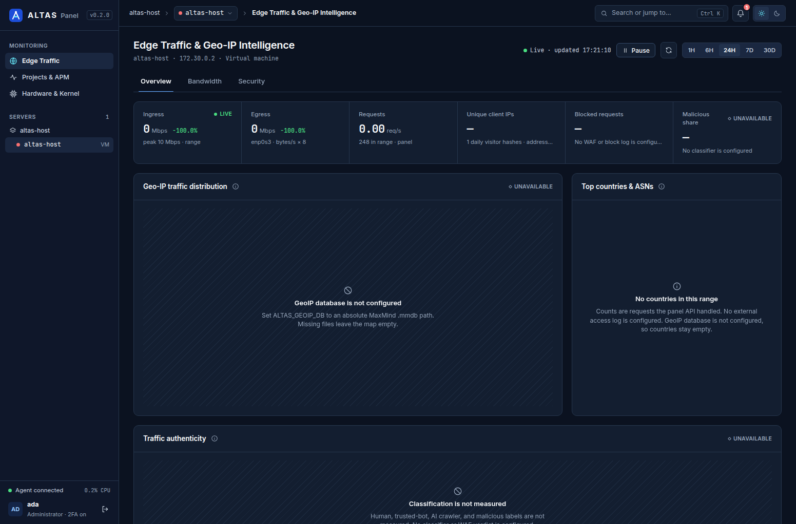
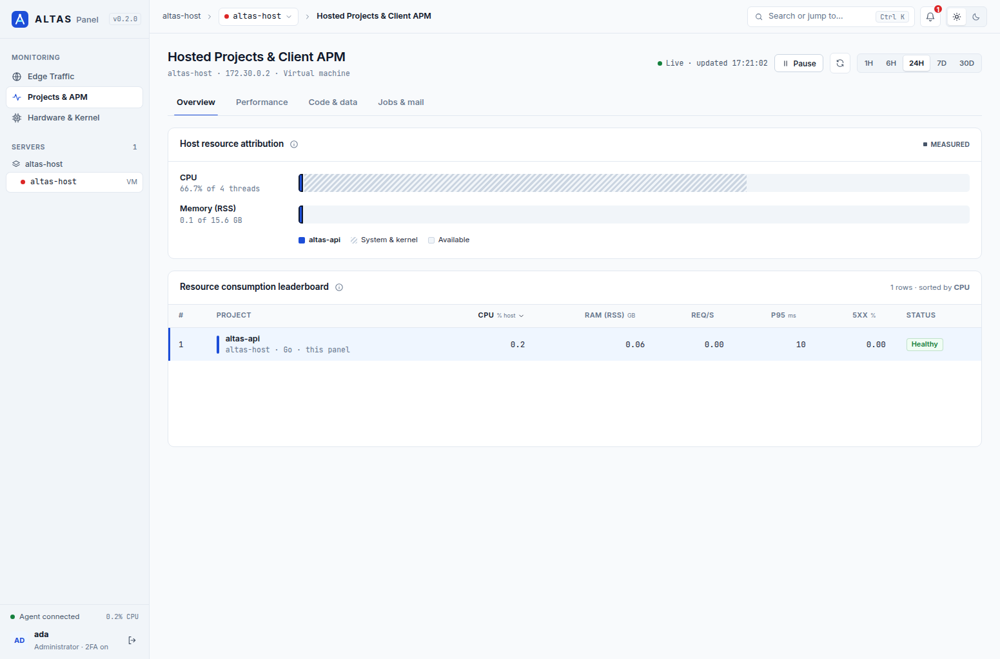
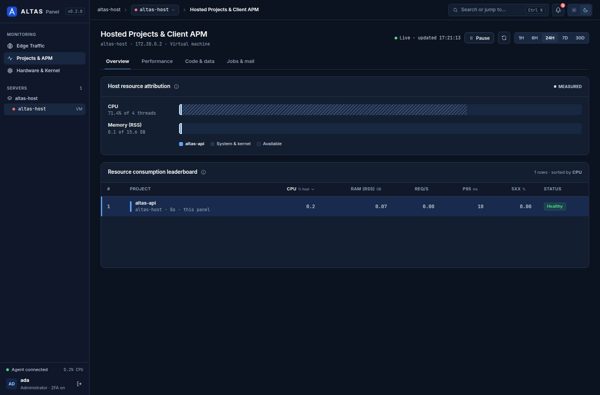
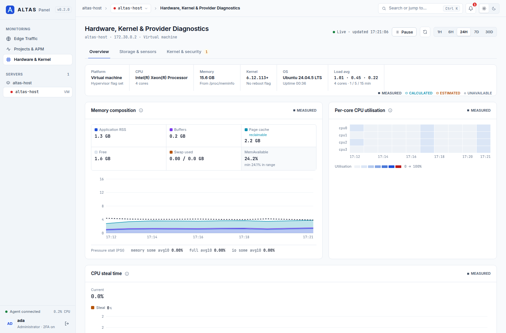
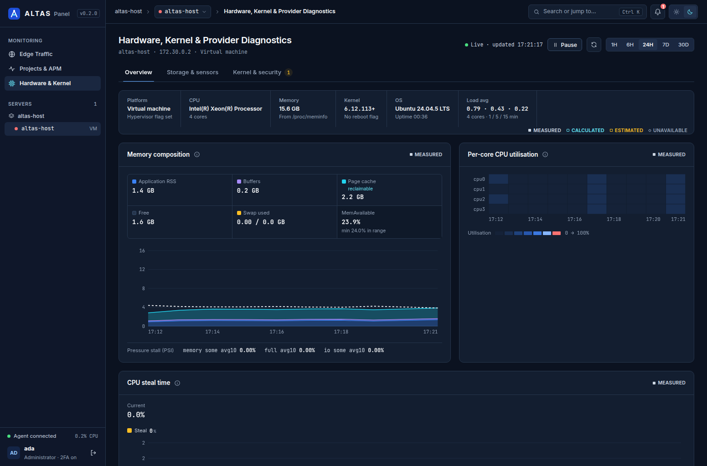
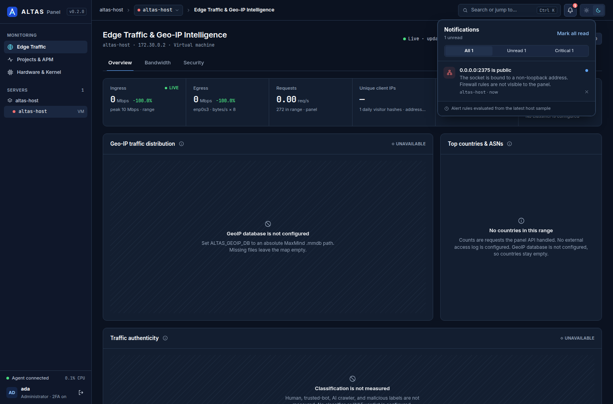

# Altas Panel

[](https://github.com/junaidrehman04/altas-panel/stargazers)
[](LICENSE)
[](go.mod)
[](https://github.com/junaidrehman04/altas-panel/issues)

Ultra-lightweight open-source control panel for a 1GB VPS and a 64-core dedicated box, from the same plane. Product home: [altaspanel.tech](https://altaspanel.tech).

Altas reads true server state from `/proc`. Cache is not reported as memory full. The monitoring agent is built to stay under 20MB resident. The panel API targets about 15–40MB idle, so the host keeps its RAM for the workloads on it. The same control plane is the path to multi-server, multi-domain, and multi-email operations, with an AI Server Doctor on top of that telemetry.

**v0.3.0** is the first release with an official host installer. The monitoring shell is unchanged: Edge Traffic, Projects & APM, and Hardware, in light and dark, with numbers from this host. A missing source stays empty. The Edge map fills from GeoLite2-Country when `MAXMIND_LICENSE_KEY` is set, and stays empty when it is not. Authenticator sign-in is real TOTP. WebAuthn is shown and does not sign anyone in. Admins turn on auto-update from the command palette. The design notes are [docs/architecture/phase-1-stacks-monitoring.md](docs/architecture/phase-1-stacks-monitoring.md), [docs/architecture/analytics-metrics.md](docs/architecture/analytics-metrics.md), and [docs/architecture/auto-update.md](docs/architecture/auto-update.md).

## How Altas works


1. **Install** — `curl -fsSL https://get.altaspanel.tech | sudo bash`
2. **Add server** — Connect VPS or dedicated hosts into one quiet panel
3. **Manage domains & mail** — SSL, multi-domain, multi-mailbox from one place
4. **Monitor** — True-State metrics + AI Server Doctor

The official install is the one-liner below. It works once a `v*` GitHub Release is published and [get.altaspanel.tech](https://get.altaspanel.tech) proxies `scripts/install.sh`. Until that release exists, the command exits with a clear message and the [quick start](#quick-start) still runs the panel from source or Compose.

## Install

### Official one-liner

```bash
curl -fsSL https://get.altaspanel.tech | sudo bash
```

That host is the marketing site. It should proxy the stable script in this repository:

`https://raw.githubusercontent.com/junaidrehman04/altas-panel/main/scripts/install.sh`

The same file is attached to each GitHub Release as `install.sh`. The script on `main` is the one to proxy so the installer can be fixed without waiting for a panel release. It only downloads artifacts from `github.com` (or from loopback when `ALTAS_DOWNLOAD_BASE` points at a local test). It checks `SHA256SUMS` before it writes anything, creates a system user named `altas`, a data directory, `/etc/altas/altas.env` with an empty `MAXMIND_LICENSE_KEY`, and a `altas-panel` systemd unit. Re-running it upgrades the binary and keeps the database and env file.

```bash
sudo bash scripts/install.sh --version v0.3.0
sudo bash scripts/install.sh --uninstall
sudo bash scripts/install.sh --uninstall --purge
```

`ALTAS_VERSION` selects the same tag as `--version`. After install, open the printed URL. The first account you register becomes the admin. Auto-update stays off until that admin enables it. Details are in [docs/architecture/auto-update.md](docs/architecture/auto-update.md).

### Release process

Tag a commit and push the tag. `.github/workflows/release.yml` builds the web UI, embeds it in the API, cross-compiles `altas-panel-linux-amd64` and `altas-panel-linux-arm64`, packs each binary into a tarball, writes `SHA256SUMS`, and publishes a GitHub Release that also contains `install.sh`. Auto-update installs the raw binary. The installer installs the tarball. Both names are in `SHA256SUMS`.

```bash
git tag v0.3.0
git push origin v0.3.0
```

Pull requests run `.github/workflows/ci.yml` (`go test ./...` and `npm run build`).

Docker Compose and a source checkout remain available below. Compose does not use this installer. Leave auto-update off for a Compose install. `docker compose restart api` restarts the existing image. It does not replace it.

### Docker Compose

Docker Compose builds the API and the web image and publishes them on localhost only.

```bash
docker compose up --build
```

Open [http://127.0.0.1:8088](http://127.0.0.1:8088). The API is also on [http://127.0.0.1:8080](http://127.0.0.1:8080). SQLite lives in the `altas-data` volume. The API starts as root only long enough to hand that volume to uid 65532, then serves as that user.

Host `/proc` and `/` are mounted read-only so the overview describes the machine, not the container's own cgroup. Remove those two mounts if you only want the container view. The Docker socket is not mounted. Compose project inventory stays off unless you set `ALTAS_DOCKER_PROBE=1` and mount a socket yourself. See the comments in `docker-compose.yml`.

For a dev container with the Go and Vite servers:

```bash
docker compose -f docker-compose.dev.yml up --build
```

That file is for local iteration. It is not the production privilege model. The web app is on [http://127.0.0.1:5173](http://127.0.0.1:5173).

### From source

You need Go 1.22 or newer and Node.js 22 or newer.

API:

```bash
cd apps/api
go run ./cmd/server
```

The API listens on [http://127.0.0.1:8080](http://127.0.0.1:8080).

Web, in a second terminal:

```bash
cd apps/web
npm install
npm run dev
```

Open [http://127.0.0.1:5173](http://127.0.0.1:5173). The dev server proxies `/api` to the Go process.

## Features

| Capability | Status |
| --- | --- |
| Accounts, sessions, password reset, first admin then closed registration | Implemented |
| TOTP enrollment, recovery codes, six-digit sign-in, 15-minute lockout | Implemented |
| 14-day “keep me signed in”, otherwise a browser session and a 12-hour server expiry | Implemented |
| Edge, Projects & APM, and Hardware shell, light and dark, command palette, shortcuts | Implemented |
| Notifications from host thresholds and sign-in events | Implemented |
| True-state host metrics from `/proc` (CPU, memory composition, disk, network, per-core) | Implemented |
| History for 1h, 6h, 24h, 7d, and 30d | Implemented |
| Panel request rollups (requests, visitors, bytes, errors, p95, paths) | Implemented |
| GeoLite2 country map and table (automatic download when `MAXMIND_LICENSE_KEY` is set; empty when it is not) | Implemented |
| Combined access-log tail (`ALTAS_ACCESS_LOG`) | Implemented, off by default |
| Read-only container list when a Docker socket is present | Implemented |
| Listening sockets, deleted-open files, mdstat, NVMe sysfs, crontab and mail log when readable | Implemented |
| IPMI, SMART wear, firewall rules, traffic classes, per-IP tables, queues, SQL, object cache | Empty until a real source exists |
| WebAuthn / security key sign-in | Coming (the tab does not sign you in) |
| One-shot monitoring agent (`apps/api/cmd/agent`) | Implemented |
| Stack registry: Docker Compose, Laravel, Next.js | Implemented (list only) |
| Read-only local Compose inventory | Implemented, off by default |
| Path jail and command allowlist | Implemented |
| Report-only malware hook (no auto-delete, ClamAV not executed) | Implemented |
| Auto-update from the command palette (Updates). SHA256 is required. Ed25519 also runs when a public key is set; a project key is not pinned yet | Implemented |
| Container create / start / stop from templates | Coming |
| File manager | Coming |
| Multi-server host picker | Coming (this release shows the local host only) |
| External access-log ingest beyond the optional file tail | Coming |
| Malware scanning beyond the hook | Coming |
| Official installer (`scripts/install.sh`, systemd, SHA256). The one-liner works after a `v*` release is published and get.altaspanel.tech proxies that script | Implemented |
| Multi-domain and SSL | Coming |
| Multi-email / mail suite (DKIM, SPF, DMARC) | Coming |
| AI Server Doctor | Coming |

### GeoIP setup

The Edge Traffic map and country table read a local GeoLite2-Country database. They stay empty when that file is missing. The panel does not invent countries.

1. Create a free GeoLite2 license key at [maxmind.com/en/geolite2/signup](https://www.maxmind.com/en/geolite2/signup).
2. Set `MAXMIND_LICENSE_KEY` in the server environment. Docker Compose reads it from the shell or a `.env` file next to `docker-compose.yml`. The key stays on the server. Do not commit it, and do not commit a GeoLite2 `.mmdb`.
3. Optionally set `ALTAS_GEOIP_DB` to an absolute path. When it is unset and the key is set, the database is written beside the SQLite file as `GeoLite2-Country.mmdb` (`/data/GeoLite2-Country.mmdb` in Compose).

On start, a missing file is downloaded (edition `GeoLite2-Country`), checked against MaxMind's SHA256 file when that file is published, and opened to confirm it is a Country database. The reader reloads without a restart. A weekly refresh replaces the file only after those checks pass. A failed refresh keeps the previous file and logs the failure without the key or the download URL.

This product includes GeoLite2 data created by MaxMind, available from https://www.maxmind.com.

## Screenshots

These are the v0.2.0 panel on a live host. Empty panels are sources this machine does not have (no GeoIP database, no access-log classifier, no IPMI). The host name in the pictures is the machine that was running the panel.

### Sign in







### Edge





### Projects





### Hardware







Domains and mail in the older images under `docs/images/` are the later product direction. They are not screens in this release.

## Quick start

Follow [Docker Compose](#docker-compose) or [From source](#from-source). On a fresh database, sign-in offers to create the admin account. After that, registration closes. The shell opens on Edge Traffic. Projects and Hardware are in the sidebar. `G` then `E`, `A`, or `H` jumps between them, and Ctrl/Cmd+K opens the command palette. Sign out is on the user row. History charts stay empty until the collector has two buckets in the selected range.

### Password reset without mail

This release does not send email. With `ALTAS_ENV=development` (the default), a forgot-password request stores a single-use token and prints the full reset URL to the API stdout:

```text
reset url: http://127.0.0.1:5173/reset-password?token=...
```

Open that URL, set a new password, and sign in again. Existing sessions for the account are revoked. Set `ALTAS_ENV=production` when you do not want reset URLs in the log.

## Auth model

Most panels do not leave public registration open. Altas does not either, after the box has an owner.

- The first successful `POST /api/auth/register` creates the panel admin (`is_admin = 1`) and a session.
- If any user already exists, public register responds with `403` and `Public registration is closed. The first account is the panel admin; further accounts will be invite-only.`
- `GET /api/auth/registration` returns `{"open": true}` only while the user table is empty. The web UI hides the create-account form once it is closed.
- Later accounts are invite-only. Admin-created users are not in this release.
- Databases created before this gate gain an `is_admin` column on the next API start. The earliest account is marked admin, and public registration is closed.
- A password login can require a TOTP code after the account enrolls an authenticator. Five failures lock sign-in for 15 minutes. Reset still revokes every session for the account.
- Keep me signed in for 14 days stores a 14-day session. Leaving it unchecked stores a 12-hour session and a cookie the browser drops when it closes. Omitting the field keeps `ALTAS_SESSION_TTL`.

## Architecture

True state means reading the kernel, not a second runtime parked beside it. `/proc` separates application RAM from buffer and cache, which is the difference between "the box is full" and "the page cache is doing its job." The monitoring agent target stays under 20MB resident. The API target is about 15–40MB idle. Multi-server comes later: many hosts, one plane, still that small.

v0.3.0 reads the local host, keeps a short SQLite history of those readings, rolls up requests the API handled, serves the panel UI from the same binary, and can update that binary from official GitHub Releases. The locked foundation is [docs/architecture/phase-1-stacks-monitoring.md](docs/architecture/phase-1-stacks-monitoring.md). Rollups, retention, and the IP policy are [docs/architecture/analytics-metrics.md](docs/architecture/analytics-metrics.md). The updater design is [docs/architecture/auto-update.md](docs/architecture/auto-update.md).

## Checks

From the repository root:

```bash
go test ./...
cd apps/web && npm run build
```

`go test ./...` also works from `apps/api`.

## Layout

```text
apps/api/cmd/server          API process
apps/api/cmd/agent           One-shot host metrics reader
apps/api/internal/auth       Argon2id passwords, sessions, reset tokens, first-admin gate
apps/api/internal/httpapi    Chi routes
apps/api/internal/db         SQLite schema (pure Go driver)
apps/api/internal/metrics    /proc host summaries and SQLite history
apps/api/internal/analytics  Request rollups, privacy truncation, optional log tail
apps/api/internal/geoip      GeoLite2-Country download and weekly refresh
apps/api/internal/window     Shared time-range parsing
apps/api/internal/security   Path jail and command allowlist
apps/api/internal/stacks     Stack registry and read-only Compose probe
apps/api/internal/malware    Report-only scanner hook
apps/api/internal/update     Official release check, checksum, install, rollback
apps/api/internal/version    Build version string
apps/api/internal/webui      Panel UI embedded in release binaries
apps/web                     Vite + React + Tailwind shell
scripts/install.sh           Official host installer
.github/workflows            CI and GitHub Release publishing
docker-compose.yml           Production-style panel deploy
docker-compose.dev.yml       Dev containers
docs/architecture            Phase 1 design
docs/images                  Panel mockups used in this README
```

The Go module lives at the repository root so one `go test ./...` covers the API. `cd apps/api && go run ./cmd/server` still runs the server.

## Configuration

The API reads its environment directly. See `.env.example`.

| Variable | Default | Purpose |
| --- | --- | --- |
| `ALTAS_ADDR` | `:8080` | Listen address |
| `ALTAS_DB` | `data/altas.db` | SQLite file, relative to the API working directory |
| `ALTAS_ENV` | `development` | `production` stops printing reset URLs |
| `ALTAS_WEB_ORIGIN` | `http://127.0.0.1:5173` | Origin used in the logged reset link |
| `ALTAS_SESSION_TTL` | `168h` | Session lifetime when the client does not send `remember`. Checked “keep me signed in” is 14 days. Unchecked is 12 hours and a browser session cookie |
| `ALTAS_ORG` | empty | Name in the sidebar. Empty uses the host name |
| `ALTAS_RESET_TTL` | `1h` | Reset token lifetime |
| `ALTAS_HOST_PROC` | `/proc` | Proc tree for host metrics |
| `ALTAS_HOST_ROOT` | `/` | Prefix for disk mount points |
| `ALTAS_PROJECTS_ROOT` | `/var/lib/altas/projects` | Future project jail. Not written yet |
| `ALTAS_DOCKER_PROBE` | off | `1` / `true` / `yes` / `on` lists local Compose projects |
| `ALTAS_DOCKER_SOCKET` | empty | Optional Docker socket. Empty uses the default paths |
| `ALTAS_UPDATE_OWNER` | `junaidrehman04` | GitHub owner for release checks. Invalid names fall back to the default |
| `ALTAS_UPDATE_REPO` | `altas-panel` | GitHub repository. Invalid names fall back to the default |
| `ALTAS_UPDATE_INTERVAL` | `12h` | Time between scheduled checks. Values below 6h become 6h. Values above 24h become 24h |
| `ALTAS_UPDATE_UNIT` | `altas-panel` | systemd unit restarted after a successful install |
| `ALTAS_UPDATE_RESTART` | `systemd` | `systemd` runs `systemctl restart`. `none` replaces the file and does not restart it |
| `ALTAS_UPDATE_BINARY` | this process | Absolute path of the binary to replace |
| `ALTAS_UPDATE_PUBKEY` | empty | Hex Ed25519 public key. Empty keeps the SHA256 checksum as the gate |
| `ALTAS_METRICS_INTERVAL` | `15s` | How often host history is sampled. Below 5s or above 5m falls back to 15s |
| `MAXMIND_LICENSE_KEY` | empty | MaxMind GeoLite2 license key. Empty leaves the map empty unless `ALTAS_GEOIP_DB` already points at a database. Never logged |
| `ALTAS_GEOIP_DB` | empty, or `GeoLite2-Country.mmdb` beside `ALTAS_DB` when a key is set | Absolute path of the country database |
| `ALTAS_ACCESS_LOG` | empty | Optional Combined access log to tail. Empty leaves external ingest off |

`ALTAS_DOCKER_PROBE` accepts only those on values and `0` / `false` / `no` / `off`. Anything else leaves the probe off.

The release API host is `https://api.github.com` in production. `ALTAS_UPDATE_API_BASE` is ignored unless `ALTAS_ENV=development`, and then only a loopback URL is accepted, so tests can publish a fake release. Scheduled checks do not call GitHub until an admin enables auto-update. The process wakes about once a minute. A manual check while auto-update is off does not consume that schedule. GitHub is contacted at `ALTAS_UPDATE_INTERVAL` (6–24 hours, default 12). Check now and Apply are limited to once a minute. When auto-update is on, a verified newer release is installed and the `altas-panel` unit restarts. A bad checksum is refused. If the new process does not stay active, the previous binary is restored from `.bak`. For Compose, leave auto-update off and restart the image with `docker compose restart api`. That restarts the container. It does not replace the image.

## How sign-in works

Passwords are stored as Argon2id (19 MiB, 2 iterations, 1 lane). A session is an opaque id in the `altas_session` cookie: `HttpOnly`, `SameSite=Lax`, and `Secure` when the request is HTTPS. The database stores a SHA-256 of that id, and logout sets `revoked_at` so the cookie cannot be reused. Reset tokens are stored the same way, work once, and a successful reset revokes every session for the account.

## Author

Muhammad Junaid Rehman Siddiqui — [junaidrehman04](https://github.com/junaidrehman04)

## License

MIT. See [LICENSE](LICENSE).

## Contributing

See [CONTRIBUTING.md](CONTRIBUTING.md).
