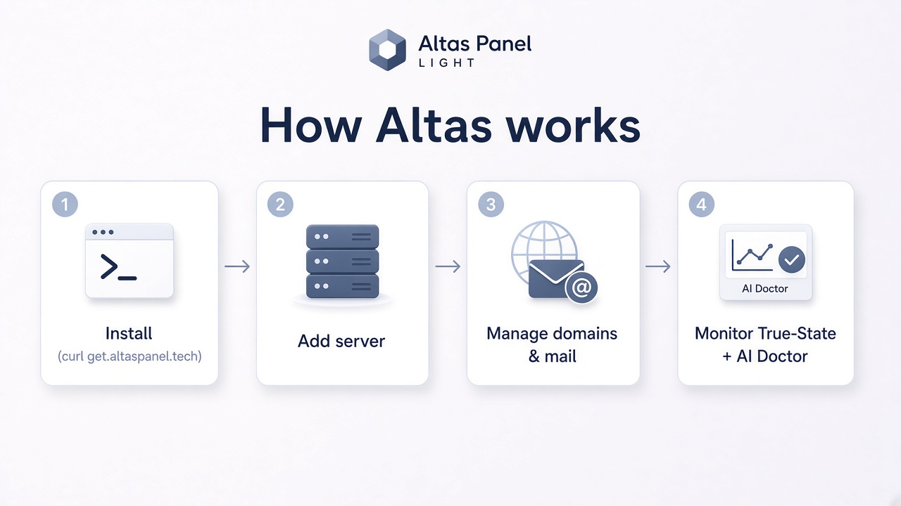
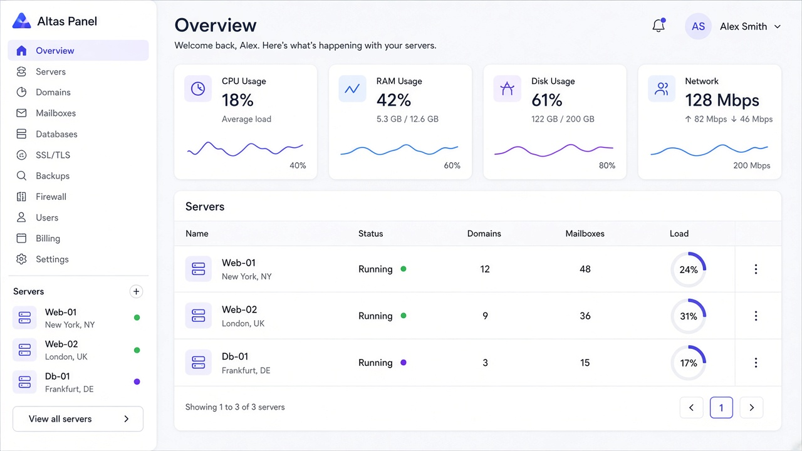
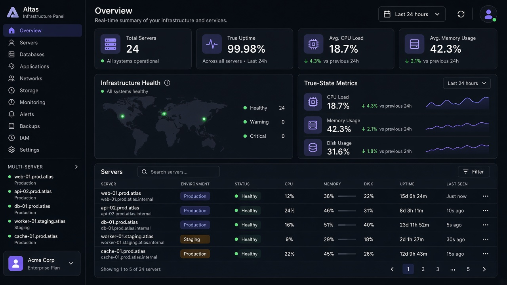
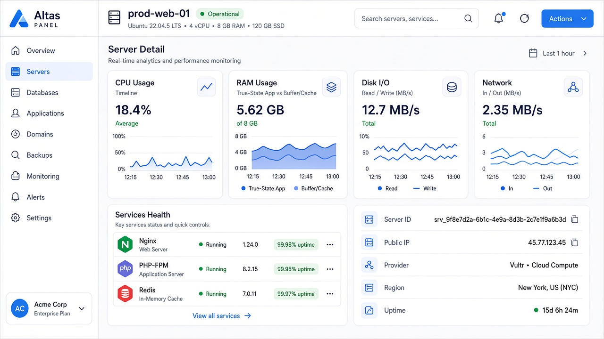
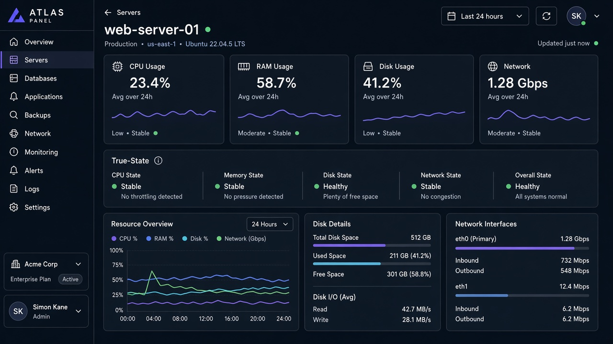
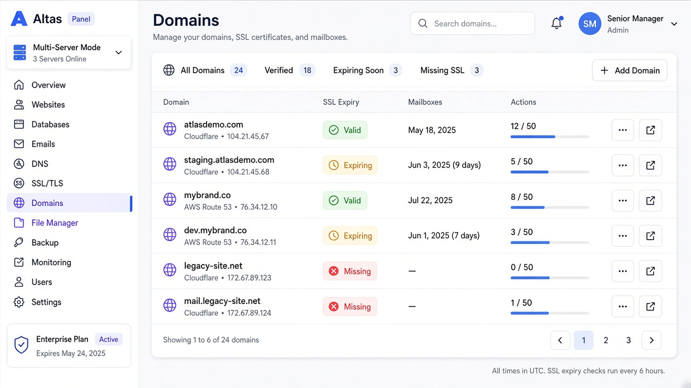
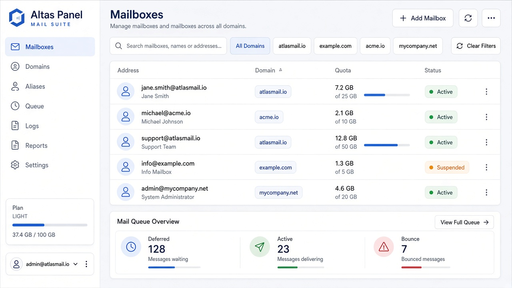

# Altas Panel

[](https://github.com/junaidrehman04/altas-panel/stargazers)
[](LICENSE)
[](go.mod)
[](https://github.com/junaidrehman04/altas-panel/issues)

Ultra-lightweight open-source control panel for a 1GB VPS and a 64-core dedicated box, from the same plane. Product home: [altaspanel.tech](https://altaspanel.tech).

Altas reads true server state from `/proc`. Cache is not reported as memory full. The monitoring agent is built to stay under 20MB resident. The panel API targets about 15–40MB idle, so the host keeps its RAM for the workloads on it. The same control plane is the path to multi-server, multi-domain, and multi-email operations, with an AI Server Doctor on top of that telemetry.

**v0.2.0-dev** keeps the v0.1.0 door and adds the first room. The first account is still the admin, public registration still closes, and sessions and password reset are unchanged. The signed-in overview now shows this host's CPU, memory, disk, and network. Stack kinds are registered. Creating containers, the file manager, analytics, and malware scanning are not in this version. The design is [docs/architecture/phase-1-stacks-monitoring.md](docs/architecture/phase-1-stacks-monitoring.md).

## How Altas works



1. **Install** — `curl -fsSL https://get.altaspanel.tech | sudo bash`
2. **Add server** — Connect VPS or dedicated hosts into one quiet panel
3. **Manage domains & mail** — SSL, multi-domain, multi-mailbox from one place
4. **Monitor** — True-State metrics + AI Server Doctor

`get.altaspanel.tech` is the planned install host. The script is not live yet. Until it is, use the [quick start](#quick-start) below.

## Install

### Planned one-liner

`get.altaspanel.tech` is the install host target. It is not serving the installer yet.

```bash
curl -fsSL https://get.altaspanel.tech | sudo bash
```

Until the one-liner is live, run the panel with Docker Compose or from source. Auto-update is not part of this release. Once it ships, it applies only after that install: a settings toggle checks GitHub Releases, verifies the checksum, restarts safely, and rolls back if the new build does not come up.

### Docker Compose

Docker Compose builds the API and the web image and publishes them on localhost only.

```bash
docker compose up --build
```

Open [http://127.0.0.1:8088](http://127.0.0.1:8088). The API is also on [http://127.0.0.1:8080](http://127.0.0.1:8080). SQLite lives in the `altas-data` volume. The API starts as root only long enough to hand that volume to uid 65532, then serves as that user.

Host `/proc` and `/` are mounted read-only so the overview describes the machine, not the container's own cgroup. Remove those two mounts if you only want the container view. The Docker socket is not mounted. Compose project inventory stays off unless you set `ALTAS_DOCKER_PROBE=1` and mount a socket yourself. See the comments in `docker-compose.yml`.

For a dev container with the Go and Vite servers:

```bash
docker compose -f docker-compose.dev.yml up --build
```

That file is for local iteration. It is not the production privilege model. The web app is on [http://127.0.0.1:5173](http://127.0.0.1:5173).

### From source

You need Go 1.22 or newer and Node.js 22 or newer.

API:

```bash
cd apps/api
go run ./cmd/server
```

The API listens on [http://127.0.0.1:8080](http://127.0.0.1:8080).

Web, in a second terminal:

```bash
cd apps/web
npm install
npm run dev
```

Open [http://127.0.0.1:5173](http://127.0.0.1:5173). The dev server proxies `/api` to the Go process.

## Features

| Capability | Status |
| --- | --- |
| Accounts, sessions, password reset, signed-in shell | Implemented |
| First admin, then closed public registration | Implemented |
| Docker Compose deploy of this panel | Implemented |
| True-state host metrics from `/proc` (CPU, memory, disk, network) | Implemented |
| One-shot monitoring agent (`apps/api/cmd/agent`) | Implemented |
| Stack registry: Docker Compose, Laravel, Next.js | Implemented (list only) |
| Read-only local Compose inventory | Implemented, off by default |
| Path jail and command allowlist | Implemented |
| Report-only malware hook (no auto-delete, ClamAV not executed) | Implemented |
| Auto-update (settings toggle, GitHub Releases check, checksum verify, safe restart, rollback) | Coming (planned next) |
| Container create / start / stop from templates | Coming |
| File manager | Coming |
| Analytics and geo traffic | Coming |
| Malware scanning beyond the hook | Coming |
| `get.altaspanel.tech` installer | Coming (not live) |
| Multi-server | Coming |
| Multi-domain and SSL | Coming |
| Multi-email / mail suite (DKIM, SPF, DMARC) | Coming |
| AI Server Doctor | Coming |

## Screenshots

Panel mockups for the product Altas is building. This repository now shows local host metrics and a stack registry. It does not yet match the multi-server, domain, and mail mockups. [altaspanel.tech](https://altaspanel.tech) will carry the public site; a preview build is at [altas-marketing.vercel.app](https://altas-marketing.vercel.app).

### Overview





### Server





### Domains



### Mail



## Quick start

Follow [Docker Compose](#docker-compose) or [From source](#from-source). On a fresh database the register screen creates the admin account and signs you in. The overview polls host metrics. Stacks lists the registry and, unless you enable it, says the Docker probe is off. Sign out from the top bar. After the first account exists, the register screen closes and unauthenticated visits to the overview return to sign-in.

### Password reset without mail

This release does not send email. With `ALTAS_ENV=development` (the default), a forgot-password request stores a single-use token and prints the full reset URL to the API stdout:

```text
reset url: http://127.0.0.1:5173/reset-password?token=...
```

Open that URL, set a new password, and sign in again. Existing sessions for the account are revoked. Set `ALTAS_ENV=production` when you do not want reset URLs in the log.

## Auth model

Most panels do not leave public registration open. Altas does not either, after the box has an owner.

- The first successful `POST /api/auth/register` creates the panel admin (`is_admin = 1`) and a session.
- If any user already exists, public register responds with `403` and `Public registration is closed. The first account is the panel admin; further accounts will be invite-only.`
- `GET /api/auth/registration` returns `{"open": true}` only while the user table is empty. The web UI hides the create-account form once it is closed.
- Later accounts are invite-only. Admin-created users are not in this release.
- Databases created before this gate gain an `is_admin` column on the next API start. The earliest account is marked admin, and public registration is closed.
- Login, logout, session cookies, and password reset are unchanged. Reset still revokes every session for that account.

## Architecture

True state means reading the kernel, not a second runtime parked beside it. `/proc` separates application RAM from buffer and cache, which is the difference between "the box is full" and "the page cache is doing its job." The monitoring agent target stays under 20MB resident. The API target is about 15–40MB idle. Multi-server comes later: many hosts, one plane, still that small.

v0.2.0-dev reads the local host, registers stack kinds, and deploys the panel with Compose. The locked design, including what is deliberately not built yet, is [docs/architecture/phase-1-stacks-monitoring.md](docs/architecture/phase-1-stacks-monitoring.md).

## Checks

From the repository root:

```bash
go test ./...
cd apps/web && npm run build
```

`go test ./...` also works from `apps/api`.

## Layout

```text
apps/api/cmd/server          API process
apps/api/cmd/agent           One-shot host metrics reader
apps/api/internal/auth       Argon2id passwords, sessions, reset tokens, first-admin gate
apps/api/internal/httpapi    Chi routes
apps/api/internal/db         SQLite schema (pure Go driver)
apps/api/internal/metrics    /proc host summaries
apps/api/internal/security   Path jail and command allowlist
apps/api/internal/stacks     Stack registry and read-only Compose probe
apps/api/internal/malware    Report-only scanner hook
apps/web                     Vite + React + Tailwind shell
docker-compose.yml           Production-style panel deploy
docker-compose.dev.yml       Dev containers
docs/architecture            Phase 1 design
docs/images                  Panel mockups used in this README
```

The Go module lives at the repository root so one `go test ./...` covers the API. `cd apps/api && go run ./cmd/server` still runs the server.

## Configuration

The API reads its environment directly. See `.env.example`.

| Variable | Default | Purpose |
| --- | --- | --- |
| `ALTAS_ADDR` | `:8080` | Listen address |
| `ALTAS_DB` | `data/altas.db` | SQLite file, relative to the API working directory |
| `ALTAS_ENV` | `development` | `production` stops printing reset URLs |
| `ALTAS_WEB_ORIGIN` | `http://127.0.0.1:5173` | Origin used in the logged reset link |
| `ALTAS_SESSION_TTL` | `168h` | Session lifetime |
| `ALTAS_RESET_TTL` | `1h` | Reset token lifetime |
| `ALTAS_HOST_PROC` | `/proc` | Proc tree for host metrics |
| `ALTAS_HOST_ROOT` | `/` | Prefix for disk mount points |
| `ALTAS_PROJECTS_ROOT` | `/var/lib/altas/projects` | Future project jail. Not written yet |
| `ALTAS_DOCKER_PROBE` | off | `1` / `true` / `yes` / `on` lists local Compose projects |
| `ALTAS_DOCKER_SOCKET` | empty | Optional Docker socket. Empty uses the default paths |

`ALTAS_DOCKER_PROBE` accepts only those on values and `0` / `false` / `no` / `off`. Anything else leaves the probe off.

## How sign-in works

Passwords are stored as Argon2id (19 MiB, 2 iterations, 1 lane). A session is an opaque id in the `altas_session` cookie: `HttpOnly`, `SameSite=Lax`, and `Secure` when the request is HTTPS. The database stores a SHA-256 of that id, and logout sets `revoked_at` so the cookie cannot be reused. Reset tokens are stored the same way, work once, and a successful reset revokes every session for the account.

## Author

Muhammad Junaid Rehman Siddiqui — [junaidrehman04](https://github.com/junaidrehman04)

## License

MIT. See [LICENSE](LICENSE).

## Contributing

See [CONTRIBUTING.md](CONTRIBUTING.md).
